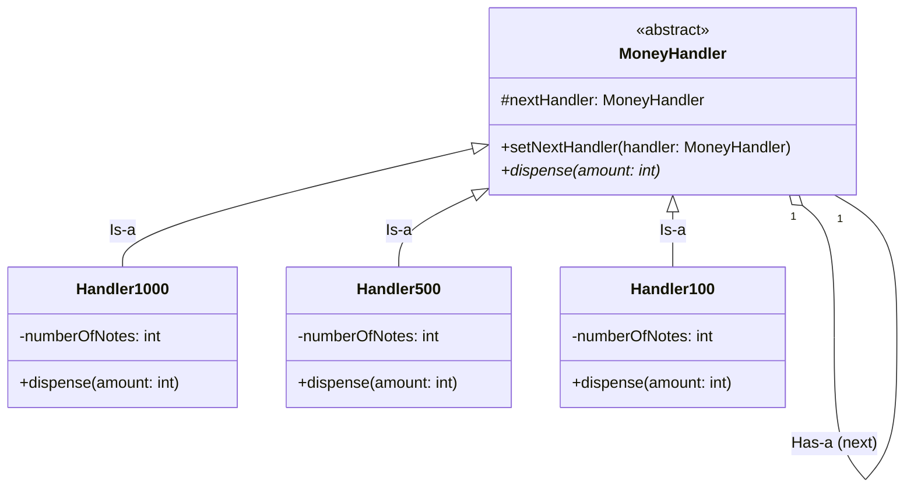

# Day 22 - Chain of Responsibility (CoR) Design Pattern

## 1. The Core Concept
The **Chain of Responsibility** is a behavioral design pattern that lets you pass requests along a chain of handlers. Upon receiving a request, each handler decides either to process the request (partially or fully) or to pass it to the next handler in the chain.

**The Golden Rule:** It decouples the sender of a request from its receivers by giving more than one object a chance to handle the request.

---

## 2. The Problem (The ATM Dispenser)
Imagine building the cash dispensing logic for an ATM. A user requests ₹3,000. 
The ATM has different denominations: ₹1000, ₹500, ₹200, and ₹100.

*   **Bad Design (Tight Coupling):** Writing a massive `if-else` or `switch` block inside a single `CashDispenser` class to calculate how many notes of each denomination to dispense. 
*   **The Issue:** This violates the **Single Responsibility Principle (SRP)** and the **Open/Closed Principle (OCP)**. If the bank introduces a new ₹50 note, or if the ₹500 note is demonetized and changes dimensions, you have to modify the core dispensing logic, risking bugs across the whole system.

---

## 3. The Chain of Responsibility Solution
We create standalone handler classes for each denomination and link them together.



### The Workflow:
1.  **The Base Handler (`MoneyHandler`):** An abstract class that holds a reference to the `nextHandler`.
2.  **The Concrete Handlers:** `Handler1000`, `Handler500`, etc. When `dispense(amount)` is called:
    *   It calculates how many notes it can provide.
    *   It deducts that amount.
    *   If a remaining amount exists, it passes the remainder to `nextHandler.dispense(remainingAmount)`.
3.  **The Chain Setup:** The client dynamically links them: `handler1000.setNext(handler500); handler500.setNext(handler100);`

---

## 4. Java Implementation

```java
// 1. Abstract Handler
abstract class MoneyHandler {
    protected MoneyHandler nextHandler;

    public void setNextHandler(MoneyHandler nextHandler) {
        this.nextHandler = nextHandler;
    }

    public abstract void dispense(int amount);
}

// 2. Concrete Handlers
class Handler1000 extends MoneyHandler {
    private int numberOfNotes;

    public Handler1000(int notes) { this.numberOfNotes = notes; }

    @Override
    public void dispense(int amount) {
        int notesNeeded = amount / 1000;
        int notesToDispense = Math.min(notesNeeded, numberOfNotes);
        
        if (notesToDispense > 0) {
            System.out.println("Dispensing " + notesToDispense + " notes of ₹1000");
            numberOfNotes -= notesToDispense;
        }
        
        int remainingAmount = amount - (notesToDispense * 1000);
        
        if (remainingAmount > 0 && nextHandler != null) {
            nextHandler.dispense(remainingAmount);
        } else if (remainingAmount > 0) {
            System.out.println("Insufficient funds in ATM. Remaining ₹" + remainingAmount + " cannot be dispensed.");
        }
    }
}

class Handler500 extends MoneyHandler {
    // Similar implementation for 500...
}

// 3. Client Code
public class Main {
    public static void main(String[] args) {
        // Initialize handlers with note counts
        MoneyHandler h1000 = new Handler1000(5);
        MoneyHandler h500 = new Handler500(10);
        MoneyHandler h100 = new Handler100(20);

        // Set the Chain of Responsibility
        h1000.setNextHandler(h500);
        h500.setNextHandler(h100);

        // Client only talks to the first handler in the chain
        System.out.println("Requesting ₹3600:");
        h1000.dispense(3600); 
        // Output: 3 notes of 1000, 1 note of 500, 1 note of 100
    }
}
```

---

## 5. CoR vs. Linked List
While visually similar, they are fundamentally different:
*   **Intent:** A Linked List is a **Data Structure** designed to store data. CoR is a **Behavioral Pattern** designed to process requests.
*   **Nodes:** In a Linked List, every node is identical in structure and type. In CoR, the "nodes" are completely different concrete classes (`Handler1000`, `Handler500`) that just happen to share a common interface.

---

## 6. Real-World Applications & Use Cases
1.  **Loggers:** Designing a Logging framework where `InfoLogger` -> `DebugLogger` -> `ErrorLogger` are chained. If an error comes in, Info ignores it, Debug ignores it, and Error processes it.
2.  **Leave Approval System:** An Employee requests 10 days of leave. The request goes to the `TeamLead` (can only approve <= 2 days) -> `Manager` (can approve <= 5 days) -> `Director` (can approve > 5 days).
3.  **Web Request Filters / Middleware:** In Spring Boot or Express.js, an incoming HTTP request passes through a chain of filters: `AuthenticationFilter` -> `LoggingFilter` -> `RateLimitingFilter`. If one fails, the chain breaks and returns an error.
