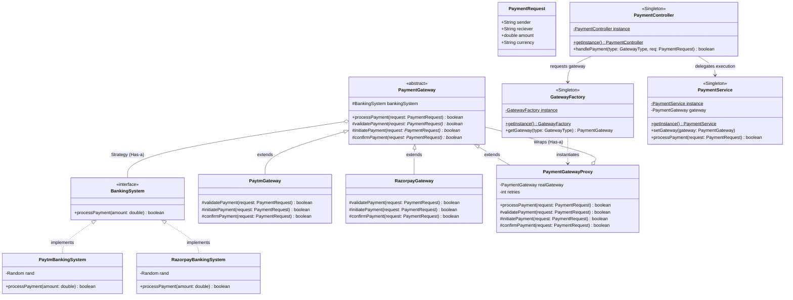
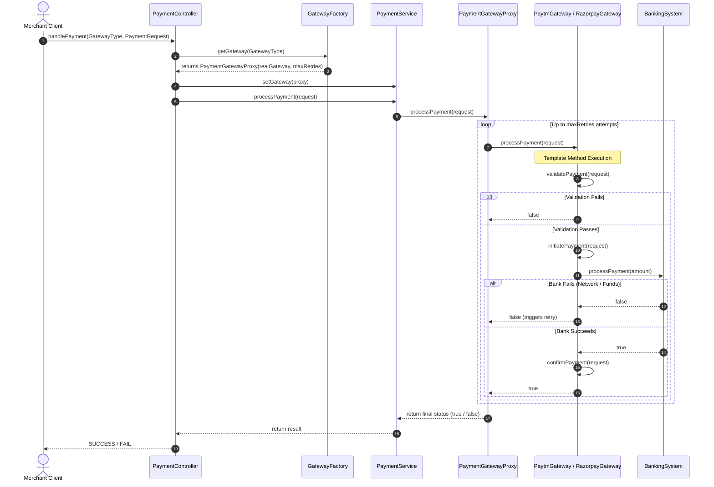

# Day 23 - Low-Level Design (LLD) of a Payment Gateway System

## 1. Introduction & Real-World Context
In modern software engineering, online transactions are the lifeblood of e-commerce, ride-sharing, and subscription platforms. Designing a **Payment Gateway System** (akin to **Razorpay**, **Stripe**, **PayPal**, or **Paytm**) is one of the most frequently asked Low-Level Design (LLD) and Machine Coding interview problems at Tier-1 tech companies.

### What is a Payment Gateway?
A Payment Gateway acts as a secure, intelligent intermediary between:
1. **The Merchant Application** (e.g., Swiggy, Amazon, Uber)
2. **The Customer's Payment Method** (Credit/Debit Card, UPI, NetBanking, Wallet)
3. **The Banking Ecosystem / Payment Processors** (Acquiring Bank, Card Networks like Visa/Mastercard, Issuing Bank, NPCI)

Instead of the merchant having to integrate directly with hundreds of individual banks with differing APIs, communication protocols, and failure modes, the Payment Gateway provides a **unified, resilient, and plug-and-play API**.

---

## 2. Requirements Gathering

### Functional Requirements
* **Multi-Gateway / Multi-Provider Integration:** Support multiple payment providers and banking rails (e.g., Paytm, Razorpay, Stripe) with dynamic switching.
* **Standardized Payment Flow:** Every payment must follow an invariant lifecycle:
  1. `validatePayment()`: Check request parameters, supported currencies, and transaction limits.
  2. `initiatePayment()`: Send the debit request to the banking processor.
  3. `confirmPayment()`: Record the transaction outcome, update ledger/status, and trigger merchant callbacks.
* **Transient Failure Retries:** If a payment attempt fails due to temporary network issues or flaky bank servers, the system must automatically retry up to a configured threshold without client intervention.
* **Unified Client API:** The client application (Merchant) should only communicate with a single controller entry point without knowing gateway-specific internal details.

### Non-Functional Requirements
* **Extensibility (Open/Closed Principle):** Adding a new gateway (e.g., PhonePe, Cashfree) or a new banking rail (e.g., Crypto, NetBanking) must not require modifying existing core orchestration logic.
* **Loose Coupling:** The gateway pipeline must remain decoupled from specific bank APIs.
* **Fault Tolerance & Resilience:** Gateway failures must be isolated, allowing fallback and transparent retries.
* **Idempotency & Consistency:** The system must guarantee that a transaction is never executed twice for the same payment intent.

---

## 3. Design Patterns Applied & Architectural Rationale

To build a modular, testable, and production-ready system, we combine five core design patterns:

### A. Strategy Pattern (Banking System Integrations)
* **Problem:** Each bank or payment processor has distinct communication protocols, endpoints, and response structures. Hardcoding bank calls inside gateway classes creates tight coupling.
* **Solution:** Define a `BankingSystem` interface with a `processPayment(double amount)` method. Concrete implementations (`PaytmBankingSystem`, `RazorpayBankingSystem`) encapsulate provider-specific integration logic.
* **Benefits:** Any payment gateway can dynamically plug in different banking strategies or mock banking engines for automated testing.

### B. Template Method Pattern (Payment Lifecycle Skeleton)
* **Problem:** The sequence of payment execution must be invariant across all gateways: Validation $\rightarrow$ Initiation $\rightarrow$ Confirmation. If left unstructured, different gateway developers might forget validation or execute confirmation out of order.
* **Solution:** Create an abstract base class `PaymentGateway` containing a concrete `processPayment(PaymentRequest request)` method. This template method enforces the exact execution order while delegating the individual steps (`validatePayment`, `initiatePayment`, `confirmPayment`) to subclasses as abstract methods.
* **Benefits:** Guarantees structural consistency across all payment providers while allowing custom step logic.

### C. Proxy Pattern (Decoupled Retry Logic)
* **Problem:** Banking networks are prone to intermittent network drops and transient 5xx errors. We need retry logic, but hardcoding loops inside every concrete gateway violates the Single Responsibility Principle (SRP).
* **Solution:** Create `PaymentGatewayProxy`, which implements `PaymentGateway` and wraps a `realGateway`. When `processPayment()` is called, the proxy intercepts the execution, running a retry loop up to `maxRetries` if initiation fails.
* **Benefits:** The real gateway remains completely oblivious to retry policies. Retries can be dynamically tuned (e.g., Paytm with 3 retries, Razorpay with 1 retry) without touching gateway business logic.

### D. Factory Method Pattern (Gateway & Proxy Assembly)
* **Problem:** Instantiating a gateway requires wiring its specific banking strategy and configuring its proxy retry wrappers. Exposing this complex instantiation logic to the client creates tight coupling.
* **Solution:** A `GatewayFactory` encapsulates gateway creation based on a `GatewayType` enum. It constructs the concrete gateway, wraps it with its pre-configured `PaymentGatewayProxy`, and returns the ready-to-use gateway.

### E. Singleton Pattern (Centralized Coordinators)
* **Problem:** Creating multiple instances of factories, controllers, and services wastes resources and introduces inconsistent runtime states.
* **Solution:** Implement `GatewayFactory`, `PaymentService`, and `PaymentController` as Singletons to serve as thread-safe, centralized access points.

### F. Controller / Facade Architecture (Client Orchestrator)
* **Problem:** Clients should not have to manually interact with the factory, retrieve proxies, and manage service state.
* **Solution:** `PaymentController` provides a single method `handlePayment(GatewayType, PaymentRequest)` that orchestrates the factory lookup, sets the active gateway in `PaymentService`, and returns the final payment result.

---

## 4. Architecture & UML Class Diagrams

### Class Diagram (Mermaid)



---

## 5. End-to-End Sequence Flow



---

## 6. Java Implementation Highlights

### 1. Template Method (`PaymentGateway.java`)
```java
abstract class PaymentGateway {
    protected BankingSystem bankingSystem;

    // The invariant template method
    public boolean processPayment(PaymentRequest request) {
        if (!validatePayment(request)) {
            System.out.println("[PaymentGateway] Validation failed for " + request.sender + ".");
            return false;
        }
        if (!initiatePayment(request)) {
            System.out.println("[PaymentGateway] Initiation failed for " + request.sender + ".");
            return false;
        }
        if (!confirmPayment(request)) {
            System.out.println("[PaymentGateway] Confirmation failed for " + request.sender + ".");
            return false;
        }
        return true;
    }

    protected abstract boolean validatePayment(PaymentRequest request);
    protected abstract boolean initiatePayment(PaymentRequest request);
    protected abstract boolean confirmPayment(PaymentRequest request);
}
```

### 2. Transparent Retry Proxy (`PaymentGatewayProxy.java`)
```java
class PaymentGatewayProxy extends PaymentGateway {
    private PaymentGateway realGateway;
    private int retries;

    public PaymentGatewayProxy(PaymentGateway gateway, int maxRetries) {
        this.realGateway = gateway;
        this.retries     = maxRetries;
    }

    @Override
    public boolean processPayment(PaymentRequest request) {
        boolean result = false;
        for (int attempt = 0; attempt < retries; ++attempt) {
            if (attempt > 0) {
                System.out.println("[Proxy] Retrying payment (attempt " + (attempt + 1)
                        + ") for " + request.sender + ".");
            }
            result = realGateway.processPayment(request);
            if (result) break;
        }
        if (!result) {
            System.out.println("[Proxy] Payment failed after " + retries
                    + " attempts for " + request.sender + ".");
        }
        return result;
    }

    @Override
    protected boolean validatePayment(PaymentRequest request) {
        return realGateway.validatePayment(request);
    }

    @Override
    protected boolean initiatePayment(PaymentRequest request) {
        return realGateway.initiatePayment(request);
    }

    @Override
    protected boolean confirmPayment(PaymentRequest request) {
        return realGateway.confirmPayment(request);
    }
}
```

---

## 7. Production Enhancements & High-Level System Design (HLD)

In a 45-minute system design interview, after writing the clean LLD code, interviewers will challenge you on real-world edge cases. Here is how to answer them:

### 1. Handling Idempotency (Preventing Double Debits)
* **The Problem:** If a client sends a payment request and experiences a network drop before receiving the HTTP 200 response, it may retry the request. If not handled, the customer will be charged twice.
* **The Solution:** Require an `Idempotency-Key` (UUID) with each payment request.
  1. The Gateway checks a distributed store (e.g., Redis) for the `Idempotency-Key`.
  2. If the key exists with status `PROCESSING` or `SUCCESS`, return the cached response immediately.
  3. If not present, store the key with a distributed lock and TTL, execute the transaction, update the status, and release the lock.

### 2. Synchronous vs. Asynchronous Workflows (Webhooks & Polling)
* In real-world gateways, payment initiation often requires **Two-Factor Authentication (2FA)**, 3D-Secure OTP verification, or asynchronous bank settlement.
* **Implementation:**
  * The gateway returns a `202 ACCEPTED` status with a redirect URL and payment intent ID.
  * Once the customer enters the OTP on the bank's page, the bank sends an asynchronous HTTP POST **Webhook** to the gateway's webhook endpoint.
  * The gateway validates the cryptographic signature of the webhook, updates the transaction status in the database, and dispatches a webhook event to the merchant app.
  * A scheduled **Reconciliation Worker** continuously polls bank APIs for any transactions stuck in `PENDING` state.

### 3. Circuit Breaker Pattern
* If HDFC Bank or SBI is undergoing planned maintenance and failing 99% of transactions, sending retries will only exacerbate server overload and degrade user experience.
* Integrate a **Circuit Breaker** (e.g., Resilience4j):
  * **Closed:** Normal traffic.
  * **Open:** When failure rate exceeds threshold (e.g., 50%), automatically trip the circuit and route transactions to an alternative bank or fail immediately with an informative message.
  * **Half-Open:** Periodically send canary requests to check if the bank has recovered.

### 4. PCI-DSS Compliance & Tokenization
* Under **PCI-DSS (Payment Card Industry Data Security Standard)**, raw Credit/Debit card numbers (PANs) and CVVs must **never** be stored on application servers.
* Payment gateways provide **client-side SDKs / Hosted Fields / iframes** that send card details directly from the user's browser to secure vault servers, returning an opaque **Payment Token** (e.g., `tok_1N3k...`) to the merchant backend.
