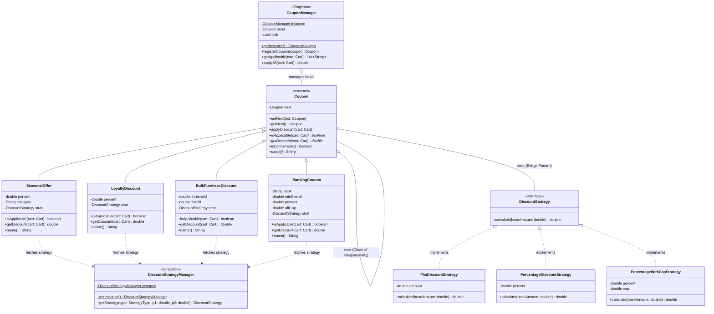
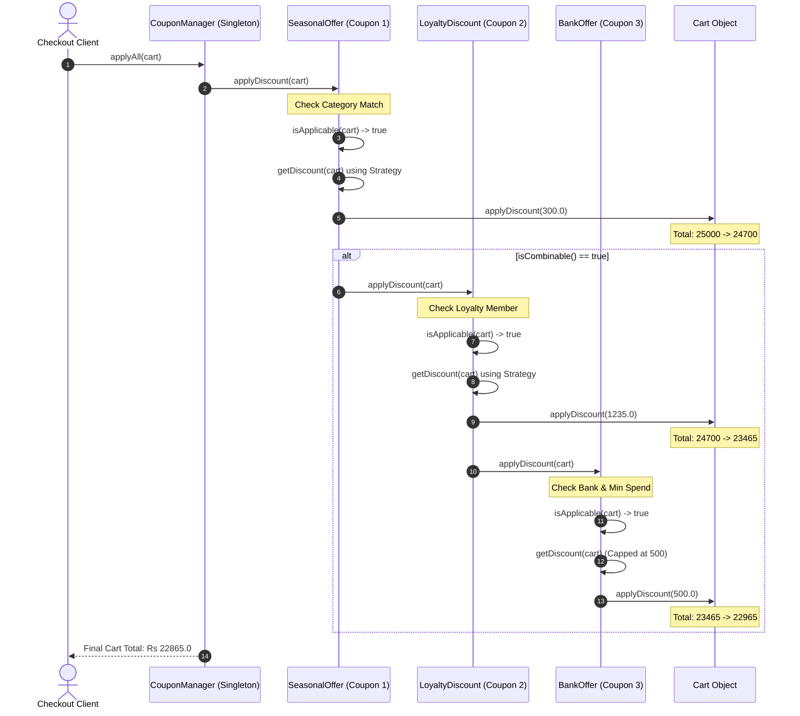

# Day 24 - Bridge Pattern + Discount Coupon Engine

## 1. Introduction & Real-World Context
In modern e-commerce systems like Amazon, Flipkart, Swiggy, and Uber, promotional discounts and coupons are critical drivers of customer acquisition and conversion. However, designing a **Discount Coupon Engine** is notoriously tricky because coupon rules evolve constantly:
* **Business Eligibility Rules** (When does a coupon apply?): Seasonal category offers, loyalty member perks, bulk order thresholds, banking/card promotions, first-time user codes.
* **Calculation Mechanisms** (How is the discount calculated?): Flat amount off, pure percentage off, percentage with an upper cap, buy-one-get-one (BOGO).
* **Combination Rules** (Can coupons be stacked?): Some coupons can be combined (e.g., Seasonal Offer + Bank Offer), while others are exclusive (e.g., clearance sales cannot stack with loyalty perks).

If you attempt to design this with basic inheritance, you will immediately hit the **Class Explosion Problem**. To build a clean, extensible, and enterprise-grade engine, we combine the **Bridge Pattern**, **Strategy Pattern**, **Chain of Responsibility (CoR)**, and **Singleton Pattern**.

---

## 2. The Core Problem: Class Explosion

Imagine we have 4 business coupon types:
1. `SeasonalOffer` (Category-specific)
2. `LoyaltyDiscount` (User tier-specific)
3. `BulkPurchaseDiscount` (Order value-specific)
4. `BankingCoupon` (Payment method-specific)

And we have 3 discount calculation types:
1. Flat Discount (e.g., ₹100 off)
2. Percentage Discount (e.g., 10% off)
3. Percentage with Cap (e.g., 15% off up to ₹500)

### Bad Approach: Monolithic Inheritance
If we combine business rules and calculation types through direct inheritance, we would need:
* `SeasonalFlatOffer`, `SeasonalPercentageOffer`, `SeasonalCappedOffer`
* `LoyaltyFlatDiscount`, `LoyaltyPercentageDiscount`, `LoyaltyCappedDiscount`
* `BulkFlatDiscount`, `BulkPercentageDiscount`, `BulkCappedDiscount`
* `BankingFlatCoupon`, `BankingPercentageCoupon`, `BankingCappedCoupon`

$$\text{Total Subclasses} = M \times N = 4 \times 3 = 12 \text{ classes}$$

If tomorrow the marketing team introduces 3 new coupon categories and 2 new calculation methods (e.g., tiered percentage, fixed price bundle), the class count explodes quadratically ($7 \times 5 = 35$ classes!).

---

## 3. The Bridge Design Pattern Solution

The **Bridge Pattern** is a structural design pattern that decouples an **Abstraction** from its **Implementation** so that both can vary independently.

```
       +-----------------------+                    +------------------------+
       |   Abstraction Hierarchy|                    | Implementation Hierarchy|
       |        (Coupon)       |<>---[ The Bridge ]--->|   (DiscountStrategy)   |
       +-----------------------+                    +------------------------+
                  |                                              |
      +-----------+-----------+                     +------------+------------+
      |           |           |                     |            |            |
   Seasonal    Loyalty     Banking                Flat       Percentage    Capped %
```

### The Roles:
1. **Abstraction (`Coupon`):** Defines the high-level business entity. It maintains a reference (`strat`) to the Implementor.
2. **Refined Abstractions (`SeasonalOffer`, `LoyaltyDiscount`, `BankingCoupon`):** Extend the business rules (checking eligibility against cart items, loyalty status, or payment bank).
3. **Implementor (`DiscountStrategy`):** Defines the interface for all calculation algorithms (`calculate(baseAmount)`).
4. **Concrete Implementors (`FlatDiscountStrategy`, `PercentageDiscountStrategy`, `PercentageWithCapStrategy`):** Encapsulate the specific mathematical computation.

$$\text{Total Classes with Bridge} = M + N = 4 + 3 = 7 \text{ classes}$$

By replacing inheritance with composition, the two hierarchies can grow independently without altering existing code (**Open/Closed Principle**).

---

## 4. Requirements Gathering

### Functional Requirements
1. **Dynamic Coupon Eligibility:** Check whether a cart qualifies for specific coupons based on products, categories, cart total, user status, or payment bank.
2. **Pluggable Discount Calculations:** Support Flat, Percentage, and Capped Percentage discount calculations across any coupon type.
3. **Coupon Chaining (Stacking):** Allow multiple coupons to be evaluated sequentially against the updated cart balance.
4. **Combinability Enforcement:** Support exclusive coupons that halt further chained discounts if applied (`isCombinable() == false`).
5. **Centralized Coupon Registry:** Manage registration, discovery of applicable coupons, and one-click application to carts.

### Non-Functional Requirements
* **Thread Safety:** The coupon registry and strategy managers must support concurrent read/write operations from multiple worker threads without data corruption.
* **Extensibility:** Adding a new coupon rule or discount formula must require zero modifications to the cart or existing coupons.
* **Precision:** Discount calculations must correctly prevent negative cart totals.

---

## 5. Design Patterns Applied

| Pattern | Component | Why Used? |
| :--- | :--- | :--- |
| **Bridge Pattern** | `Coupon` $\leftrightarrow$ `DiscountStrategy` | Decouples business rule evaluation from the math behind the discount, eliminating class explosion. |
| **Strategy Pattern** | `DiscountStrategy` Hierarchy | Encapsulates exchangeable mathematical algorithms (`Flat`, `Percentage`, `Capped`). |
| **Chain of Responsibility** | `Coupon.setNext()` $\rightarrow$ `applyDiscount()` | Chains multiple coupons sequentially, updating running cart totals and terminating early if an exclusive coupon triggers. |
| **Factory Method** | `DiscountStrategyManager.getStrategy()` | Centralizes the instantiation and parameter validation of calculation strategies. |
| **Singleton Pattern** | `DiscountStrategyManager` & `CouponManager` | Guarantees single sources of truth, global access, and synchronized thread-safety using reentrant locks. |

---

## 6. Architecture & UML Class Diagram



---

## 7. End-to-End Sequence Diagram



---

## 8. Key Implementation Highlights

### 1. The Bridge Connection in `Coupon` & Refined Subclasses
Notice how `SeasonalOffer` holds a reference to `DiscountStrategy` rather than hardcoding percentage logic or extending a `PercentageCoupon` class:

```java
class SeasonalOffer extends Coupon {
    private double percent;
    private String category;
    private DiscountStrategy strat; // The Bridge Reference

    public SeasonalOffer(double pct, String cat) {
        this.percent  = pct;
        this.category = cat;
        // Strategy injected via Factory
        this.strat    = DiscountStrategyManager.getInstance()
                            .getStrategy(StrategyType.PERCENT, percent, 0.0);
    }

    @Override
    public double getDiscount(Cart cart) {
        double subtotal = 0.0;
        for (CartItem item : cart.getItems()) {
            if (item.getProduct().getCategory().equalsIgnoreCase(category)) {
                subtotal += item.itemTotal();
            }
        }
        return strat.calculate(subtotal); // Delegates math to Implementor
    }
}
```

### 2. Chain of Responsibility with Combinability Control
In `Coupon.java`, the `applyDiscount` method updates the cart and checks if further coupons can be stacked:

```java
public void applyDiscount(Cart cart) {
    if (isApplicable(cart)) {
        double discount = getDiscount(cart);
        cart.applyDiscount(discount);
        System.out.println(name() + " applied: Rs " + discount);
        if (!isCombinable()) {
            System.out.println(name() + " is non-combinable. Halting coupon chain.");
            return; // Chain breaks!
        }
    }
    if (next != null) {
        next.applyDiscount(cart); // Forward to next handler
    }
}
```

### 3. Thread-Safe Concurrency Management
The `CouponManager` uses an explicit `java.util.concurrent.locks.ReentrantLock` ensuring atomic registration and read/write consistency during concurrent checkout flows:

```java
public void registerCoupon(Coupon coupon) {
    lock.lock();
    try {
        if (head == null) {
            head = coupon;
        } else {
            Coupon cur = head;
            while (cur.getNext() != null) {
                cur = cur.getNext();
            }
            cur.setNext(coupon);
        }
    } finally {
        lock.unlock();
    }
}
```

---

## 9. Production & High-Level Design (HLD) Extensions

In a system design interview, after demonstrating this object-oriented LLD, interviewers will ask how this scales in high-concurrency production environments:

### 1. Coupon Stacking & Priority Ordering (The 0/1 Knapsack Problem)
* **The Problem:** In our basic CoR, coupons are applied in the order they were registered. In reality, applying Coupon A before Coupon B might yield a completely different discount than applying Coupon B before Coupon A (since percentage discounts apply on updated totals).
* **The Solution:** 
  * Assign an explicit `priority` or `weight` to each coupon (e.g., Category-level discounts $\rightarrow$ Cart-level discounts $\rightarrow$ Payment/Bank discounts).
  * For advanced platforms, treat coupon stacking as a **Dynamic Programming optimization problem** (bounded Knapsack) to find the coupon combination that maximizes user savings while respecting the merchant's minimum margin threshold.

### 2. High-Concurrency Flash Sales & Usage Limits
* **The Problem:** A coupon code (e.g., `FIRST500`) has a global redemption limit of 500 uses. If 10,000 users check out concurrently, multiple threads might read `usedCount < 500` and over-redeem the coupon.
* **The Solution:**
  * Use **Redis with an atomic Lua script** or `DECRBY`:
    ```lua
    local current = redis.call('GET', KEYS[1])
    if tonumber(current) > 0 then
        redis.call('DECR', KEYS[1])
        return 1
    else
        return 0
    end
    ```
  * Maintain per-user usage tracking with Redis sets (`SADD coupon:FIRST500:users userId`).

### 3. Partial Order Cancellations & Refunds
* If a customer uses a bulk discount (e.g., ₹100 off on orders $\ge$ ₹1000) by purchasing two items for ₹500 each, and subsequently returns one item:
* The system must dynamically recalculate the cart eligibility. Since the remaining item is only ₹500, the bulk coupon eligibility is revoked, and the refund amount is adjusted:
$$\text{Refund Amount} = \text{Item Price} - \text{Discount Benefit} = ₹500 - ₹100 = ₹400$$

### 4. Rule Engine vs. Hardcoded Code
* While hardcoded classes work great for clean LLD interviews, production systems like Flipkart/Uber use **Dynamic Rule Engines** (e.g., Drools, Easy Rules, or custom AST JSON parsers).
* Marketing managers can configure rules via an admin portal without deploying new backend code:
  ```json
  {
    "couponId": "SUMMER15",
    "conditions": {
      "cartTotal": { "gte": 1500 },
      "category": "Clothing",
      "userType": "ALL"
    },
    "action": {
      "type": "PERCENT_WITH_CAP",
      "percent": 15,
      "maxCap": 300
    }
  }
  ```
